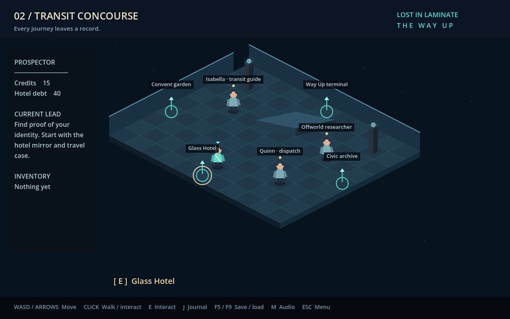

# Lost in Laminate: The Way Up

A short, complete **2D isometric narrative adventure for Godot 4.7.2**, adapted from the setting and opening mystery of *Lost in Laminate* 11.0c by GlossandGlamour.

You wake on Torei without your memories. Recover your identity, investigate a forged hotel bill, meet the people of Aekora, and choose how your journey ends.



## Play in Godot

1. Install **Godot 4.7.2 Standard** (GDScript; no .NET needed) for your operating system from [the official release](https://github.com/godotengine/godot/releases/tag/4.7.2-stable).
2. Clone/download this repository. In Godot's project manager choose **Import**, select `project.godot`, then **Import & Edit**.
3. Press **F6** with `scenes/main.tscn` open, or **F5** to run the project.
4. Select **Begin a new journey**. Expect approximately 10–20 minutes to explore the condensed story.

No plugins, asset packs, server, account, API keys, or network connection are needed to play. All artwork is drawn by the game, and the soundtrack is synthesized locally. Compatibility rendering supports modest hardware.

## Controls

| Control | Action |
| --- | --- |
| WASD / arrows | Move relative to the screen |
| Left click floor | Walk there using obstacle-aware navigation |
| Left click character / object | Approach and interact |
| E / Enter near an object | Interact |
| J | Journal and investigation leads |
| F5 / F9 | Save / load |
| M | Toggle ambient audio |
| Escape | Close dialogue / open pause menu |
| Tab / Shift+Tab / Enter | Navigate dialogue buttons |

Choices have no time limits. There is no combat or death loop. All three endings leave an option to keep exploring. The journal and long dialogue panels scroll. The game scales its 1280×800 canvas to the window.

Saving uses one atomic JSON save in Godot's `user://journey.json`; no repository files are written. Test runs use an isolated save directory.

## What is included

- Five areas: Glass Hotel, Transit Concourse, Quiet Garden, Civic Archive, and Way Up Terminal.
- Original animated vector characters, isometric architecture, plants, water, interface, icon, and synthesized ambient soundtrack.
- Eight characters, interactable scenery, inventory, journal, identity recovery, two paid quests, debt payment or dispute, and three endings.
- Keyboard movement with solid scenery, A* click-to-walk, contextual interaction prompts, save/load validation, and an accessible keyboard menu.
- A headless integration suite that plays each ending and navigates to every interactable.

**Scope:** this is a standalone, non-explicit reinterpretation, not a full port of the attachment's approximately 3,900 passages / 675,000 words / 30 endings. Its explicit sexual material and sexual coercion have not been included. Dialogue and quest structure here are newly written. See [adaptation notes](docs/ADAPTATION.md).

## Cloud / Linux development

Use the existing checkout; cloud tasks are already isolated and need no Git worktree.

```bash
./tools/setup.sh       # fetch checksum-verified Godot 4.7.2 if absent; import assets
./tools/test.sh        # isolated, headless integration suite; nonzero on failure
./tools/run.sh         # graphical play (requires a display)
./tools/run.sh --editor
```

The cloud bootstrap installs outside the checkout at `/workspace/tools/godot-4.7.2`. `GODOT_INSTALL_DIR` overrides that location for setup. `GODOT_BIN` overrides the engine path for run/test scripts. `XDG_DATA_HOME`, `XDG_CONFIG_HOME`, and `XDG_CACHE_HOME` can override cloud runtime directories. The scripts default to `/workspace/.runtime` because the cloud user's home directory is read-only.

For example, on another Linux machine:

```bash
GODOT_INSTALL_DIR="$PWD/../godot-4.7.2" \
XDG_DATA_HOME="${XDG_DATA_HOME:-$HOME/.local/share}" \
XDG_CONFIG_HOME="${XDG_CONFIG_HOME:-$HOME/.config}" \
XDG_CACHE_HOME="${XDG_CACHE_HOME:-$HOME/.cache}" ./tools/setup.sh
GODOT_BIN="$PWD/../godot-4.7.2/Godot_v4.7.2-stable_linux.x86_64" ./tools/test.sh
```

Setup needs HTTPS access to `github.com` and its release download host `release-assets.githubusercontent.com`. There are no package-manager dependencies beyond Bash, curl, and Python 3 in the Linux bootstrap. Ordinary editor use needs only Godot.

## Validation

Tested with the official **Godot 4.7.2 stable** Linux x86_64 engine. **91 integration checks pass**, exercising three endings, reward idempotence, account settlement, save/load, invalid-save rejection, keyboard input, coordinate projection, and pathfinding to all 23 interactables. A graphical OpenGL run was also checked using Mesa software rendering on a virtual X display. Screenshots are from the actual game.

No packaged Windows/macOS/Linux executable is included; open the project in Godot to test. Windows/macOS native builds and audio playback on physical hardware have not been verified.

## Project structure

- `scripts/main.gd`: rendering, movement/navigation, UI, quests, save/load, synthesized audio.
- `scripts/story.gd`: room definitions, characters, exits, layout data.
- `scenes/main.tscn`: game entry scene.
- `tests/smoke.gd`: deterministic gameplay integration suite.
- `tests/visual.gd`: capture actual game screenshots with a graphical renderer.
- `tools/`: setup, launch and isolated test helpers.

## Attribution

The user supplied *Lost in Laminate* 11.0c (Twine/Harlowe), credited in the attachment to **GlossandGlamour**. Torei, Aekora, the title, and adapted character/location names originate from that work/shared setting. This repository does not bundle its HTML, prose, images, or external assets. All implementation, dialogue, vector visuals, and synthesized music in this adaptation were created for this project. No claim of ownership over the source setting is made; confirm source permissions before public distribution.
